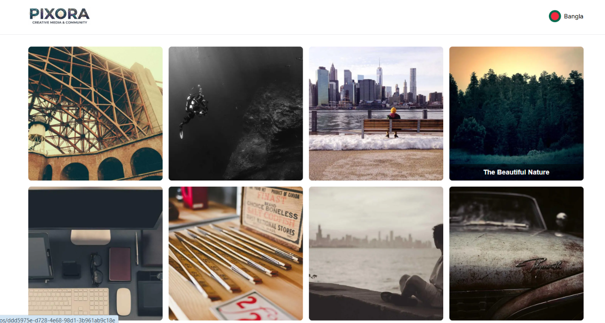

# 📸 Pixora — Discover Moments, Explore Stories

A modern and responsive photography gallery application built with **Next.js** and **Tailwind CSS**, where users can explore beautiful photographs and discover the stories behind every frame.

## 🌟 About the Project

**Pixora** is a photography gallery platform designed to showcase beautiful photographs in an elegant and user-friendly interface.

Users can browse a collection of photographs and click on any image to explore its detailed information through an interactive modal.

Each photo detail includes:

- Photographer / uploader information
- Photo title and description
- Total views
- Total likes
- Share functionality
- Photo upload date

The primary goal of Pixora is to create a simple, visually appealing photography discovery experience.

## ✨ Key Features

- **Photography Gallery:** Explore a collection of beautiful photographs.
- **Interactive Photo Modal:** Open any photo to view its detailed information.
- **Photographer Information:** See who uploaded each photograph.
- **Photo Statistics:** Display total views and likes.
- **Photo Sharing:** Share photographs with others.
- **Photo Details:** View photo titles, descriptions, and upload dates.
- **Responsive Design:** Optimized for desktop, tablet, and mobile devices.
- **Modern UI:** Clean layouts and smooth interactions.

## 🛠️ Technology Stack

| Technology        | Purpose                       |
| ----------------- | ----------------------------- |
| Next.js           | React framework               |
| React.js          | UI development                |
| Tailwind CSS      | Styling and responsive design |
| JavaScript (ES6+) | Application logic             |
| Lucide React      | Icons                         |

## 📂 Project Structure

```text
pixora/
├── public/
│   ├── images/
│   └── icons/
│
├── src/
│   ├── app/
│   │   ├── favicon.ico
│   │   ├── globals.css
│   │   ├── layout.js
│   │   └── page.js
│   │
│   ├── components/
│   │   ├── common/
│   │   │   ├── Header.jsx
│   │   │   └── Footer.jsx
│   │   │
│   │   ├── gallery/
│   │   │   ├── PhotoGallery.jsx
│   │   │   ├── PhotoCard.jsx
│   │   │   └── PhotoModal.jsx
│   │   │
│   │   └── ui/
│   │       └── Loading.jsx
│   │
│   ├── data/
│   │   └── photos.js
│   │
│   └── utils/
│       └── helpers.js
│
├── .gitignore
├── jsconfig.json
├── next.config.js
├── package.json
├── postcss.config.mjs
└── README.md
```

## 🚀 Getting Started

Follow these instructions to run Pixora locally.

### Prerequisites

Make sure you have installed:

- Node.js (LTS version recommended)
- npm, yarn, pnpm, or bun
- Git

### 1. Clone the Repository

```bash
git clone https://github.com/jalal007/pixora.git
```

### 2. Navigate to the Project Directory

```bash
cd pixora
```

### 3. Install Dependencies

```bash
npm install
```

### 4. Run the Development Server

```bash
npm run dev
```

### 5. Open in Your Browser

Visit:

```text
http://localhost:3000
```

## 📷 How It Works

1. Open Pixora and explore the photography gallery.
2. Browse the available photographs.
3. Click on any photograph to open its details modal.
4. Explore the photographer information, photo description, views, likes, and upload date.
5. Use the share option to share your favorite photograph.

## 🎨 UI & Design

Pixora focuses on:

- Minimal and modern interface
- Photography-focused visual presentation
- Clean typography
- Consistent spacing and layout
- Responsive image gallery
- Smooth modal interactions

## 🌐 Live Demo

Live URL: https://pixora-jalal007.vercel.app

## 📸 Screenshots




## 🤝 Contributing

Contributions, suggestions, and feature requests are welcome.

If you have suggestions to improve Pixora, feel free to open an issue or submit a pull request.

## 📄 License

This project is developed for learning and portfolio purposes.

---

<div align="center">

**Pixora — Discover Moments, Explore Stories.** 📸

Made with ❤️ using Next.js and Tailwind CSS.

</div>
