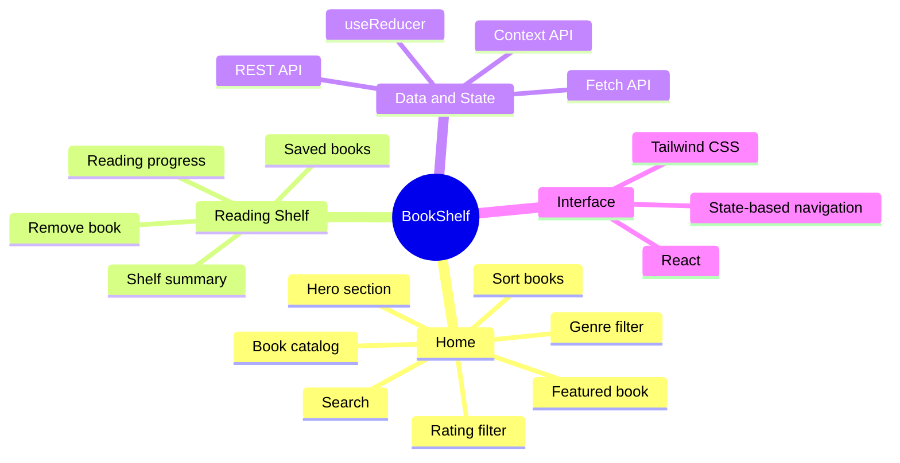

# BookShelf - Personal Reading Library


## Overview

**BookShelf** is a book discovery and personal reading-list application
built with React and JavaScript. Users can browse books, search the
catalog, filter by genre and minimum rating, sort results, and manage a
personal reading shelf. Books can be added to or removed from the shelf,
and reading progress can be updated from not started through completion.

---

## Mind Map



---

## Folder Structure

```text
src/
├── api/
│   └── readingListService.js
├── components/
│   ├── layout/
│   │   ├── Header.jsx
│   │   ├── ShelfHeader.jsx
│   │   ├── SearchBar.jsx
│   │   └── Footer.jsx
│   ├── books/
│   │   ├── HeroSection.jsx
│   │   ├── FeaturedBook.jsx
│   │   ├── BookFilters.jsx
│   │   ├── BookCatalog.jsx
│   │   ├── BookSorting.jsx
│   │   └── BookCard.jsx
│   └── shelf/
│       ├── ReadingSummary.jsx
│       ├── ShelfList.jsx
│       ├── ShelfItem.jsx
│       └── ReadingProgress.jsx
├── context/
│   └── ReadingListContext.jsx
├── hooks/
│   ├── useBooks.js
│   ├── useSearch.js
├── pages/
│   ├── HomePage.jsx
│   └── ShelfPage.jsx
├── providers/
│   └── ReadingListProvider.jsx
├── reducers/
│   └── readingListReducer.js
├── App.jsx
├── main.jsx
└── index.css
```

---

## Features

### Book discovery

- Browse the available book catalog.
- View a featured book and collection metrics.
- Search the catalog.
- Filter by genre and minimum rating.
- Sort results by newest, oldest, or highest rating.
- Keep hero metrics and the featured book based on the full collection
  while catalog results respond to search and filters.

### Personal reading shelf

- Add a book to the reading shelf.
- Remove a selected book from the shelf.
- View the number of books on the shelf.
- Track progress at **0%, 25%, 50%, 75%, and 100%**.
- View summary metrics for total books, currently reading, and
  completed books.
- Update the shelf without reloading the page.

---

## Technology Stack

- **React** --- component-based UI
- **JavaScript (ES6+)** --- no TypeScript
- **Vite** --- development server and build tooling
- **Tailwind CSS v4** --- styling
- **Fetch API** --- HTTP requests
- **Context API and `useReducer`** --- shared reading-list state
- **REST API** --- book catalog and reading-list persistence

---

## Installation and Setup

### Prerequisites

- Node.js (a version supported by the project's Vite setup)
- npm
- The BookShelf REST API backend running locally on port `4020`

### 1. Clone the repository

```bash
git clone https://github.com/jalal007/book-shelf.git
cd book-shelf
```

### 2. Install dependencies

```bash
npm install
```

### 3. Configure the API URL

The default API base URL is:

```text
http://localhost:4020/api
```

If the frontend reads the URL from a Vite environment variable, create a
`.env` file in the project root:

```env
VITE_API_BASE_URL=http://localhost:4020/api
```

### 4. Start the backend

Start the BookShelf API and confirm that it is available at
`http://localhost:4020/api`.

### 5. Start the frontend

```bash
npm run dev
```

### 6. Build for production

```bash
npm run build
npm run preview
```

---

## Usage Guide

1.  Open the Home page to browse the book catalog.
2.  Enter a search term to find books.
3.  Choose a genre or minimum rating to narrow the results.
4.  Sort results by newest, oldest, or rating.
5.  Select **Add to Shelf** on a book to save it to your reading list.
6.  Open the Reading Shelf to view saved books and summary metrics.
7.  Update a book's progress to 0%, 25%, 50%, 75%, or 100%.
8.  Select **Remove** to remove that individual book from the shelf.
9.  When the shelf is empty, use the empty-state action to return to the
    catalog.

---

## 📸 Screenshot / Demo

### Screenshot


### Live Demo

🔗 **Live Demo:** https://bookshelf-jalal.vercel.app/

### GitHub Repository

🔗 **Repository:** https://github.com/jalal007/book-shelf

---

## Contribution Guidelines

1.  Fork the repository.

2.  Create a feature branch:

    ```bash
    git checkout -b feature/your-feature
    ```

3.  Follow the existing project structure and keep changes focused.

4.  Use JavaScript and Fetch API.

5.  Test relevant API and UI states, including loading, error, empty,
    and success states.

6.  Use a descriptive commit message:

    ```bash
    git commit -m "Add descriptive feature"
    ```

7.  Push the branch and open a pull request explaining the changes.

---

## License

This project is licensed under the **MIT License**.

You are free to use, modify, and distribute this project according to the terms of the license.

---

## Credits and References

- [React documentation](https://react.dev/)
- [Vite documentation](https://vite.dev/)
- [Tailwind CSS documentation](https://tailwindcss.com/docs)
- [MDN: Fetch
  API](https://developer.mozilla.org/en-US/docs/Web/API/Fetch_API)
- [MDN:
  Array.prototype.sort()](https://developer.mozilla.org/en-US/docs/Web/JavaScript/Reference/Global_Objects/Array/sort)

---

## Author

**Jalal Ahamad**

Senior Frontend Developer

**Frontend:** React.js · Vue.js · JavaScript · Tailwind CSS

---

⭐ If you like this project, consider giving it a **star** on GitHub.
